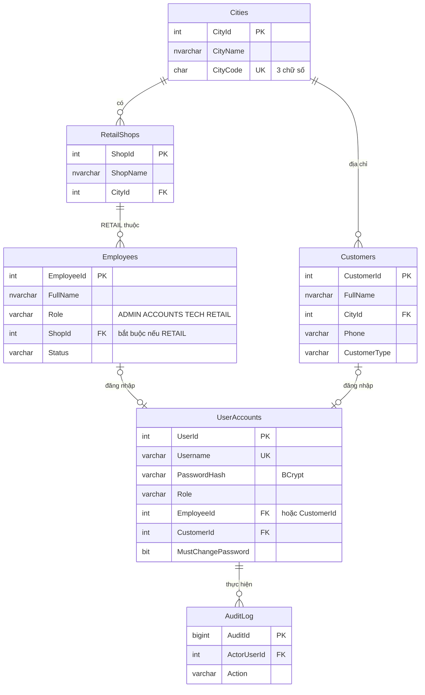
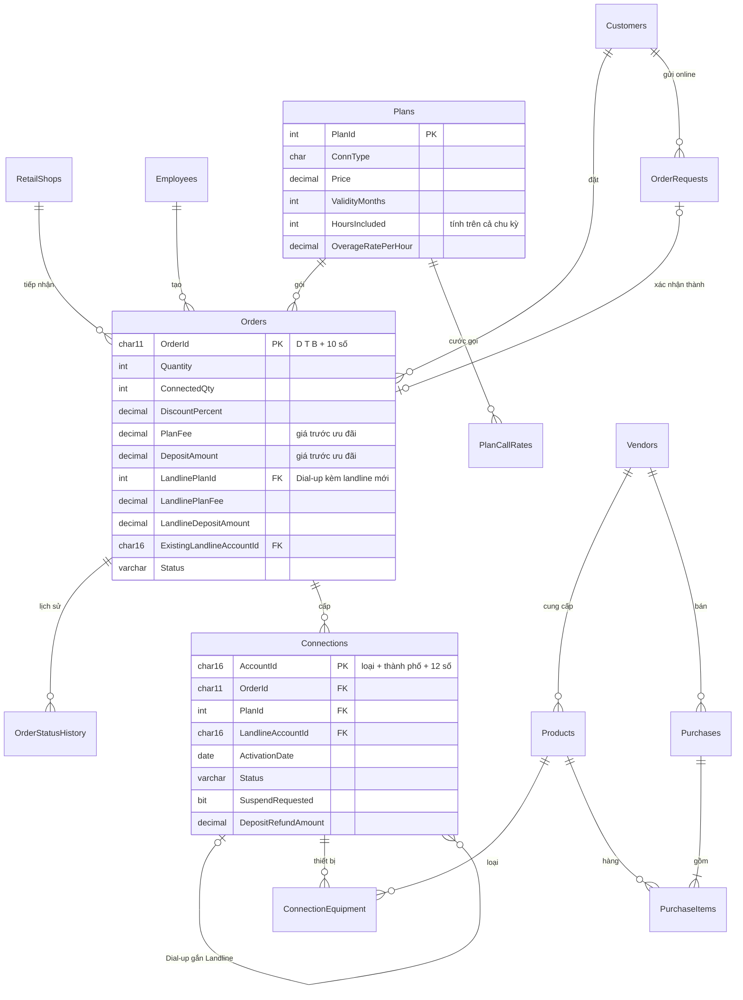
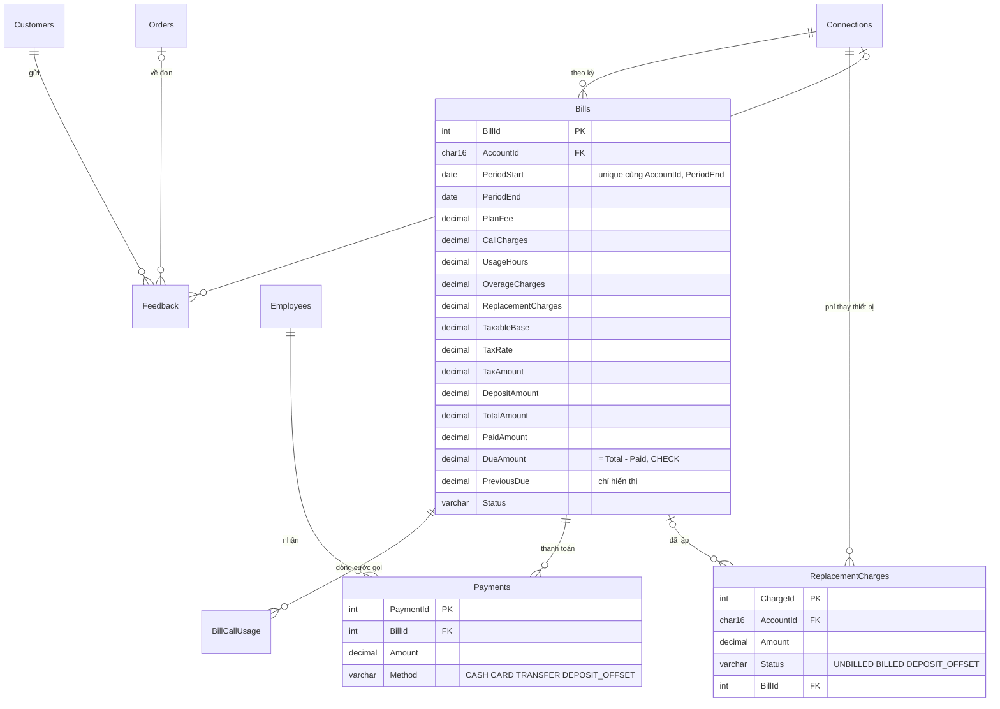

# E-R Diagram: NEXUS Service Marketing System (Task 1)

Đồng bộ với `database/schema.sql` (25 bảng). Sơ đồ tách theo nhóm để dễ đọc; GitHub và VS Code (có extension Mermaid) hiển thị trực tiếp. Khi đưa vào project report, xuất từng sơ đồ thành ảnh.

## 1. Danh mục, tài khoản

## 2. Đơn, kết nối, thiết bị

## 3. Hóa đơn, thanh toán

Bảng cấu hình không có quan hệ: `SystemConfig` (thuế, tiền cọc, số ngày), `BulkDiscounts` (bậc ưu đãi), `Sequences` (bộ đếm sinh ID).
